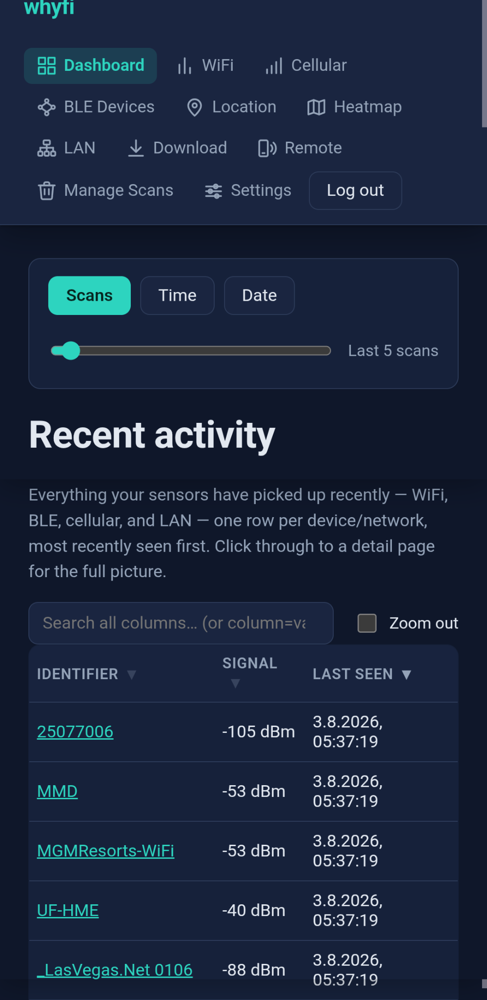
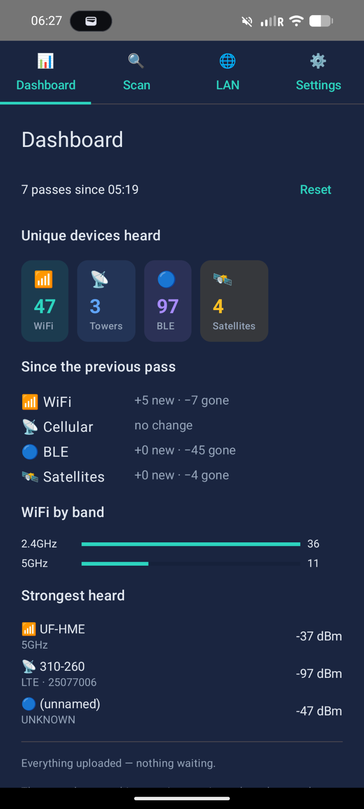
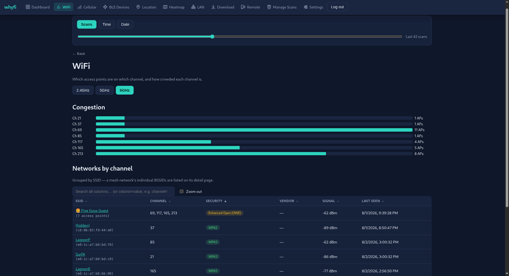
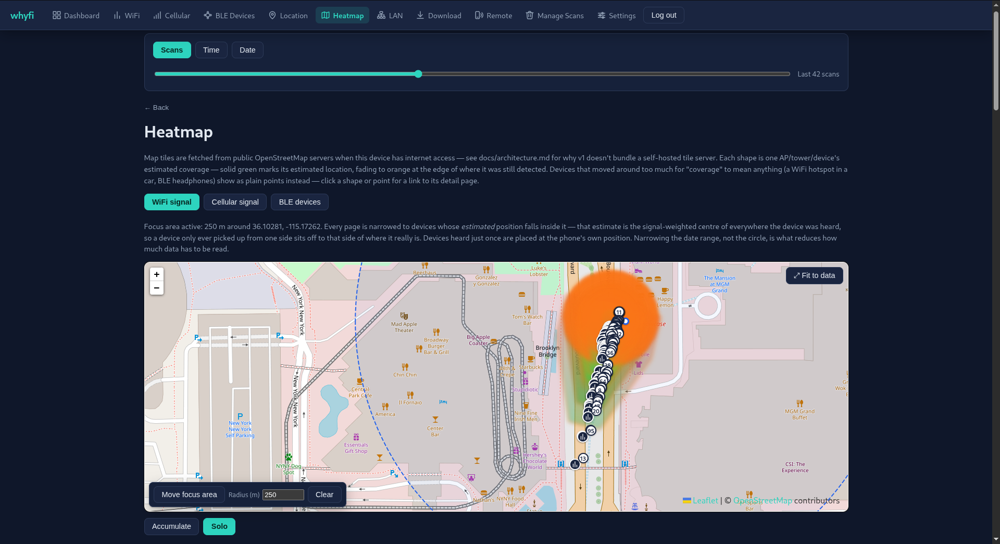
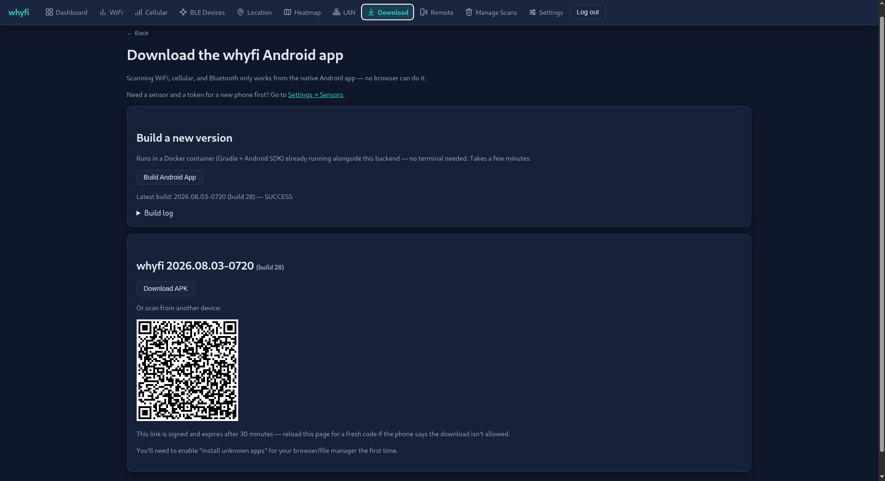
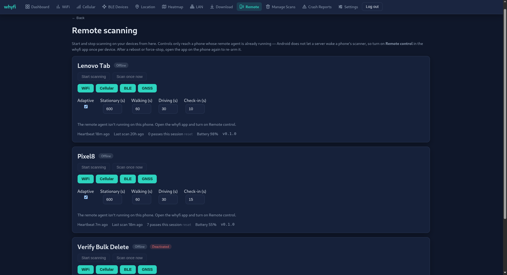

# whyfi

A self-hosted, open-source wireless survey and authorized pentesting tool in
development. The Android app scans WiFi, cellular, Bluetooth, GNSS, and your
local LAN and reports to a Dockerized Django backend; an installable PWA
visualizes the results (dashboards, signal history, channel congestion, and maps/heatmaps)
on any device, including iOS.

With a supported USB WiFi adapter, the Android app can also receive 802.11
frames in monitor mode and show nearby APs and clients locally. The Monitor
tab is always visible and becomes usable after a successful USB monitor test
in Settings. See [current capabilities and next steps](docs/roadmap.md).

See [`docs/architecture.md`](docs/architecture.md) for the design and
[`DISCLAIMER.md`](DISCLAIMER.md) for authorized-use requirements.

## Why a native Android app at all, if there's a PWA?

No mobile browser (iOS or Android) exposes an API to enumerate nearby WiFi
networks, cellular cells, or Bluetooth devices — that capability simply
doesn't exist for web content, on either platform. iOS additionally never
exposes it to *native* apps either. So the PWA is a viewer everywhere, and the
Android app is the only thing that can actually scan. See
[`docs/architecture.md`](docs/architecture.md) for the full breakdown.

## Screenshots

<table>
<tr>
<td align="center" valign="top">Mobile PWA<br/></td>
<td align="center" valign="top">Android app<br/></td>
</tr>
</table>

<table>
<tr>
<td align="center" valign="top">WiFi<br/></td>
<td align="center" valign="top">Heatmap<br/></td>
</tr>
<tr>
<td align="center" valign="top">Download APK<br/></td>
<td align="center" valign="top">Remote devices<br/></td>
</tr>
</table>

More screenshots (mobile PWA, desktop PWA, and the native Android app) in
[`docs/screenshots.md`](docs/screenshots.md).

## Quickstart

```bash
git clone --recurse-submodules https://github.com/inv1sible/whyfi.git
cd whyfi
cp .env.example .env
docker compose up
```

The Android app's native USB monitor-mode library builds from two git
submodules (`devourer`, `libusb` under `android/app/src/main/cpp/`). Without
them the Android build fails. If you already cloned without
`--recurse-submodules`, fetch them with:

```bash
git submodule update --init
```

Then open `http://localhost:8000` (or wherever you point your own reverse
proxy) and log in with the credentials from `.env`
(`DJANGO_SUPERUSER_USERNAME`/`PASSWORD` — same account as `/admin/`). From
the **Download** page, click **Build Android App** — this builds a real APK
in the already-running `android-builder` container (Gradle + Android SDK,
no Android Studio, no terminal) and registers it automatically once it
finishes, typically a few minutes. Then download/sideload it onto your
phone, create a `Sensor` in `/admin/` for its token, and paste the backend
URL + token into the app's Settings screen to start scanning.

## Layout

- `backend/` — Django + DRF + Postgres API, serves the built PWA and hosts
  APK downloads.
- `frontend/` — React + Vite PWA, built into the backend's Docker image.
- `android/` — native Kotlin scanning app, built via Docker (no emulator
  needed to produce an APK; a physical device is needed to exercise real
  radios).
- `mockloc/` — dev-only Android app for emulator testing. Spoofs GPS
  location along a configurable walk path and models a directional RSSI
  antenna pattern, so the scanner can be exercised without a physical
  device. Standalone — not part of the main build or docker-compose. See
  [`mockloc/README.md`](mockloc/README.md).
- `docs/` — architecture, API reference, deployment, and roadmap notes.

## Status

The existing survey features and USB Monitor tab support reconnaissance for
an authorized assessment. Monitor keeps its live device view on the phone;
completed missions retain a PDF, event log, and optional PCAP for explicit
upload to the private backend. The PWA lists uploaded files for download,
while packet injection, deauthentication, and packet crafting remain
unimplemented. The roadmap separates current capabilities from future work.
